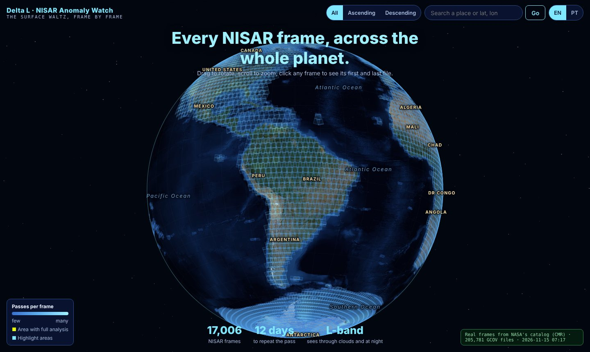
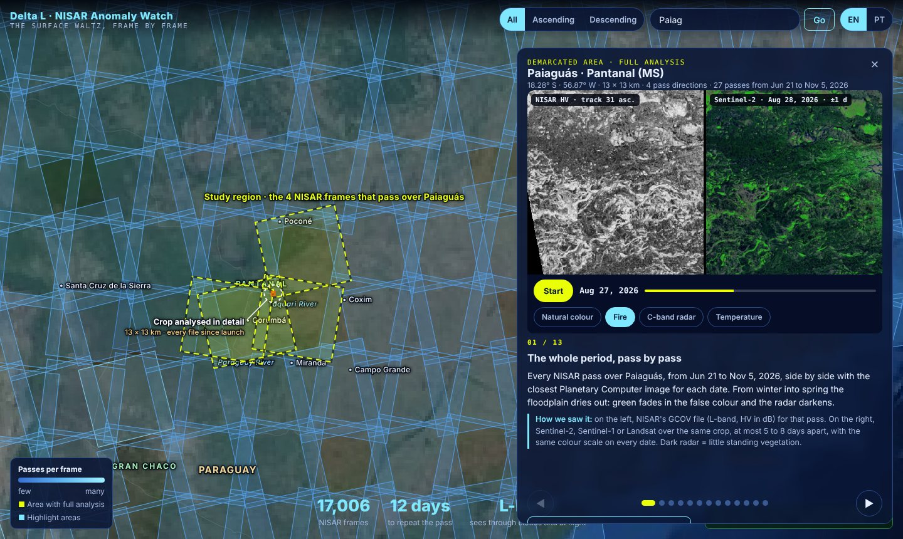
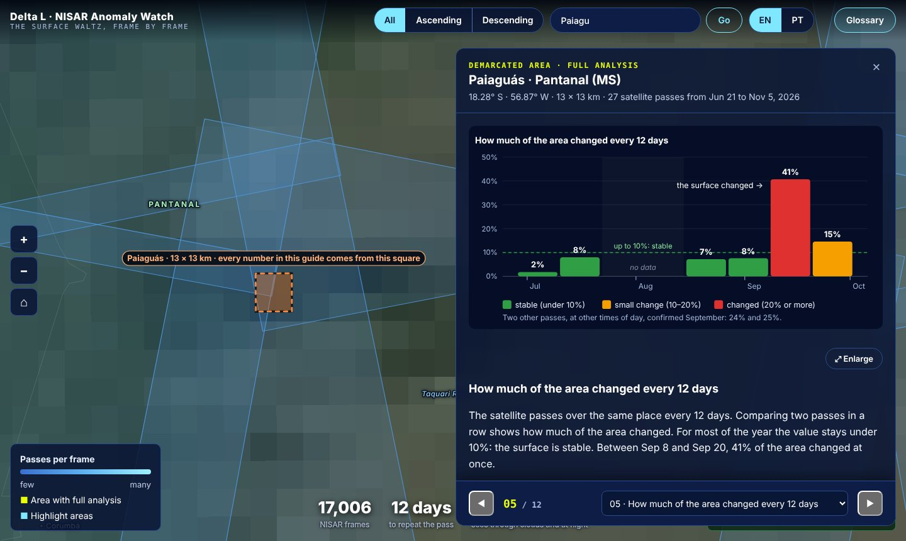
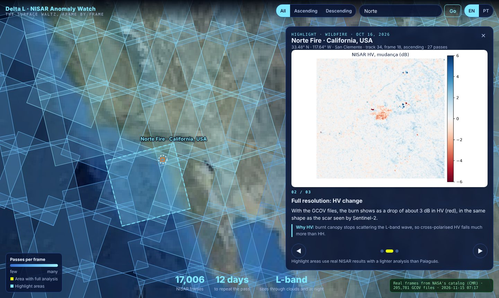

# NISAR Anomaly Watch · team Delta L

**Seeing the invisible. Showing the unpredictable, and the predictable, of life on Earth.**

NASA Space Apps Challenge 2026 · challenge *Dancing with the SARs*

🌍 **Live app:** https://7kayke.github.io/NISAR-Anomaly-Watch/  ·  explorer and technical sheet: https://7kayke.github.io/NISAR-Anomaly-Watch/app/



---

## The idea

The Earth's surface changes all the time, but most of that change is invisible to us. Clouds hide it. Smoke hides it.
Night hides it. Some of it is too subtle for any photograph: soil soaking up the first rain, a floodplain breathing with
the seasons, a pasture drying out before anyone notices a fire.

NISAR, the NASA–ISRO radar satellite, sees through all of that with its L-band wave, every 12 days, over the whole planet.
But its files are large, technical and hard to read. **NISAR Anomaly Watch turns them into a story anyone can follow:** where
the satellite looked, what changed, when, how we know it is real, and why it probably happened.

Some of those changes are **unpredictable**: a wildfire, a sudden loss of coherence. Others are **predictable**: the yearly
pulse of rain and drought, the farming calendar. The app shows both, side by side, so the unusual stands out against the
Earth's own rhythm.

## What makes it different

| | |
|---|---|
| **The whole planet, real data** | The globe draws **17,006 real NISAR frames** read from NASA's public catalog (CMR), built from **205,781 GCOV files**. Click any frame to see its first and last file and how many times NISAR passed. |
| **Three depths of analysis** | *Quick comparison* for any frame (catalog + previews, nothing to download) · *Highlight areas* with real results · *Full analysis* of one area with every file since launch. |
| **Radar next to what the eye sees** | For each NISAR pass, the closest **Sentinel-2, Sentinel-1 and Landsat** image of the same place, on the same grid and the same colour scale (Microsoft Planetary Computer). |
| **Proof without another satellite** | Each NISAR pass direction looks from a different side at a different hour. A change counts only when **independent directions agree**. Faulty passes are detected and thrown out. |
| **The invisible waltz** | Soil moisture: NISAR's HH channel and its SME2 product follow the rain (NASA POWER), before any change reaches a photograph. |
| **Explained for everyone** | A guided story with *what happened* and *how we saw it* on every slide, a glossary of every data layer, English and Portuguese. Works on phones. |
| **Open and reproducible** | Every number comes from code in this repository, with a technical sheet listing each file, date and parameter. |

## The flagship story: Paiaguás, Pantanal (Brazil)



A 13 × 13 km crop of the Pantanal floodplain (18.28° S, 56.87° W), seen by **4 NISAR pass directions, 27 passes from
21 Jun to 5 Nov 2026**, using GCOV (HH/HV backscatter), GUNW (interferometric coherence and displacement) and SME2 (soil moisture).

**What we found**

- **September, the ground changed.** Between 8 and 20 September, **41% of the area lost coherence** (below 0.3). Two other
  independent tracks saw **24–25%** in overlapping windows. Outside September it stays near **4%**; a calm control period
  (28 Jun – 10 Jul) shows **2%**.
- **Why: the first rains after a dry winter.** July and August brought only 31 mm of rain and the topsoil dried to
  0.14 m³/m³. Between 5 and 13 September about 41 mm fell, and soil moisture jumped to 0.53 m³/m³. **Every NISAR pair that
  spans 13 September lost coherence; the pairs that missed it stayed near 5%.** The rain on 30 September shows up again,
  weaker (15%), in the next pair.
- **What the eye sees agrees.** From July to October Sentinel-2 sees NDVI fall from 0.64 to 0.39 and the burnt-or-dried
  area reach 16%; Landsat measures the surface up to 13 °C warmer; Sentinel-1 darkens in September.
- **Pixel by pixel:** about 710 ha of short-lived flooding, 496 ha of permanent water, 127 ha of abrupt vegetation loss and
  684 ha of slow gain. HH follows soil moisture (r 0.59–0.81 against NISAR's SME2).



**Hypotheses, tested against the data:** (1) first rains of the wet season abruptly changing soil moisture: the timing
matches pair by pair, so it is our main explanation; (2) dry-season fire and pasture management in a cattle-ranching
region: consistent with the optical drying signal, but gradual; (3) flooding: ruled out for now, HH did not fall to
open-water levels.

## Highlight areas

| Area | Kind of change | What NISAR shows |
|---|---|---|
| **Norte Fire, San Clemente, California** | Wildfire, 16 Oct 2026 | Even the free catalog previews show a dark patch where CAL FIRE placed the fire; GCOV shows a ~3 dB HV drop in the shape of the Sentinel-2 scar. Honest limits: a ~230 ha fire on coastal hills is hard for any 12-day radar pair, and pixel-level scores are low. |
| **MATOPIBA Cerrado, Maranhão and Piauí** | Farming frontier | 18,180 ha of abrupt drops and 34,380 ha of gradual loss in the 2026 dry season, peaking 21 Jul – 14 Aug. Rain explains little here (r 0.37): land use leads the dance. |
| **Tocantins River, Maranhão–Tocantins** | Soil moisture, one point since launch | HH follows the rain (r 0.78 with antecedent rain, 0.52 with SME2). A pass where everything jumped 11.9 dB in one day was flagged as an artefact and excluded. |



## What NISAR makes possible next

Fire early warning under smoke · the Pantanal flood pulse every 12 days · soil moisture for ranchers and farmers ·
deforestation under clouds · centimetre-scale ground motion for cities and infrastructure. The same pipeline runs on any
frame of the globe.

---

## How it works

```
NASA CMR catalog ──► funnel (covers the area · one file per pass · same geometry) ──► read only the area (HDF5 subsets)
      │                                                                                     │
      │                                         GCOV HH/HV ─► dB, 3×3 mean, per-date median normalisation
      │                                                     ─► per-pixel step (t-test), slow trend, rain response ─► classes 0–8
      │                                         GUNW ──────► coherence < 0.3, displacement (cm)
      │                                         SME2 ──────► soil moisture
      ▼
cross-check across pass directions · anomalous-pass filter · Planetary Computer optical/C-band · NASA POWER rain
      ▼
technical sheet (every file) · GeoTIFF / NetCDF / GeoJSON / CSV · static web app (globe + explorer)
```

### Data sources

| Role | Data | Access |
|---|---|---|
| Main radar | NISAR L2 GCOV (HH, HV), L2 GUNW (coherence, unwrapped phase), L3 SME2 (soil moisture) | NASA CMR + ASF DAAC (Earthdata Login) |
| Global frame grid | Metadata of every NISAR GCOV file (BETA, PROVISIONAL and V1 collections) | NASA CMR, public, no download |
| Optical and C-band comparison | Sentinel-2 L2A, Landsat 8/9 C2 L2 (incl. thermal), Sentinel-1 RTC | Microsoft Planetary Computer (STAC) |
| Weather context | Daily rain, soil moisture (PRECTOTCORR, GWETTOP) | NASA POWER API |
| Basemap | Blue Marble | NASA Visible Earth |
| Reference for the fire case | Norte Fire incident report | CAL FIRE |

### Run it yourself

```bash
pip install -r requirements.txt
# NISAR needs EARTHDATA_USERNAME / EARTHDATA_PASSWORD as environment variables or in ~/.netrc

python run_quadros.py --out docs/globo/quadros.json                         # global frame grid (metadata only, ~10 min)
python run_point.py   --lat -18.278 --lon -56.873 --nome "Paiaguás" --out docs/results/ponto_paiaguas   # one point, every file since launch
python run_series.py  --case cases/paiaguas.json --out docs/results/paiaguas         # full area analysis, all pass directions
python run_carrossel.py --case cases/paiaguas.json --serie docs/results/paiaguas --out docs/results/paiaguas/carrossel
python build_app_data.py --id paiaguas --caso cases/paiaguas.json --ponto docs/results/ponto_paiaguas --serie docs/results/paiaguas
python -m pytest -q tests
```

The web app is static: `docs/` is published as-is by GitHub Pages (`docs/index.html` → globe, `docs/app/` → explorer).

### Repository map

| Path | What |
|---|---|
| `deltal/` | Library: NISAR readers, funnel, change classification, export, Planetary Computer and NASA POWER sources |
| `run_*.py` | Command-line steps (frame grid, point, series, GUNW, carousel, gallery, scouting, multi-sensor funnel) |
| `cases/` | Study areas (bbox, dates, point, context) |
| `docs/globo/` | The globe (D3, canvas) and its data |
| `docs/app/` | The explorer: change maps, validation, technical sheet, gallery |
| `docs/results/` | Every output: figures, data packages, technical sheets |
| `api/` | Optional REST API (FastAPI) that runs the same funnel on demand |

### Limitations

- NISAR data over the Pantanal starts in June 2026; there is a data gap from 27 Jul to 10 Aug and a production pause from 23 Oct to 9 Nov.
- Data before 20 Jan 2026 is BETA (before calibration) and is marked as such.
- Descending track 111 loses coherence even in calm periods over Paiaguás and is left out of conclusions about the ground.
- Highlight areas use a lighter analysis than Paiaguás. The catalog previews may require an Earthdata login to display.

## Team and use of AI

Team **Delta L** (Kayke).

| What | Who |
|---|---|
| Idea, choice of study areas, sensors and sources, the funnel and validation concepts, every decision and review | Team Delta L |
| Much of the Python and JavaScript code, comments and documentation drafts | Written with an AI assistant (Claude, Anthropic), then reviewed and run by the team |
| Numbers, maps and metrics | Computed by the pipeline from real NASA, ESA and USGS data, never written by AI |

Every Python file starts with an `# AI-assisted` note and commits made with the assistant carry a `Co-Authored-By: Claude` line.
No AI-generated images are used. The 30-second demo (`docs/demo/delta_l_demo_30s.mp4`) is a screen recording of the app, recorded and edited with the AI assistant; it carries a visible "SI-assisted" watermark and a note in its metadata. No NASA logos are used.

## License

Code under the [MIT License](LICENSE). NISAR, Sentinel, Landsat, NASA POWER and CAL FIRE data keep the terms of their providers.

## References and credits

NASA/JPL and ISRO NISAR mission, data via the Alaska Satellite Facility DAAC · NASA Common Metadata Repository (CMR) ·
ESA Copernicus Sentinel-1 and Sentinel-2 and USGS Landsat via Microsoft Planetary Computer · NASA POWER ·
NASA Visible Earth Blue Marble · Natural Earth via `world-atlas` · CAL FIRE.
Libraries: numpy, scipy, matplotlib, pyproj, rasterio, h5py, xarray, pystac-client, planetary-computer, odc-stac, earthaccess, D3, topojson.

---

### Resumo em português

**Enxergar o invisível. Mostrar o imprevisível, e o previsível, da vida na Terra.** O NISAR vê através de nuvem, fumaça e
noite a cada 12 dias, no planeta inteiro, mas seus arquivos são difíceis de ler. O NISAR Anomaly Watch transforma esses
arquivos numa história: um globo com os 17.006 quadros reais do NISAR, comparação rápida para qualquer quadro, áreas em
destaque com resultados reais e uma análise completa do Paiaguás, no Pantanal. Lá, o NISAR viu a superfície mudar em
setembro de 2026 (até 41% da área perdeu coerência, confirmado por três direções de passagem independentes) e os dados
de chuva explicaram o porquê: as primeiras chuvas depois de um inverno seco. O app está em inglês e português e funciona no celular.
